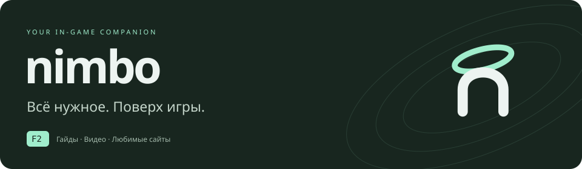
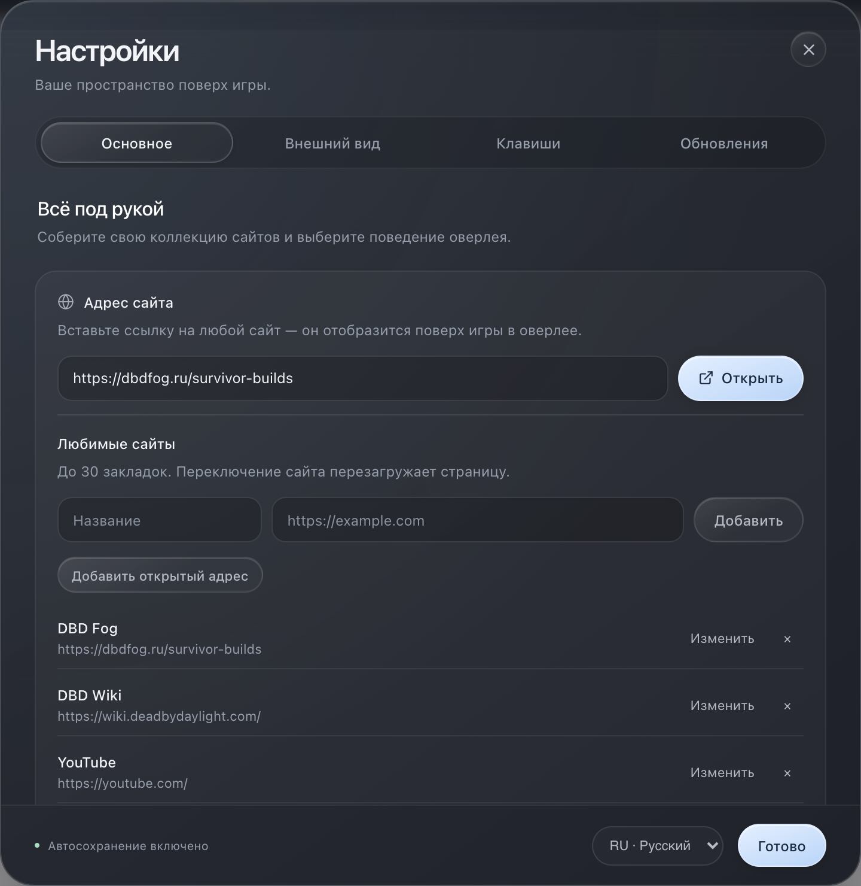

# Nimbo

Гайды, билды, видео и любимые сайты поверх игры. Одна клавиша открывает оверлей, повторное нажатие возвращает управление в игру.

**Windows 10 / 11 · x64 · Русский / English · MIT**



## Установка

1. Скачайте **`Nimbo-Setup-3.0.0.exe`** из [последнего релиза](https://github.com/dreamersadobe/multioverlay/releases/latest) или установщик более новой версии.
2. Выберите язык мастера, папку установки и нужен ли ярлык на рабочем столе. Новая установка выполняется для текущего пользователя без прав администратора.
3. Оставьте отмеченным запуск Nimbo на последнем шаге. Краткая инструкция поможет начать работу; там же можно включить автозапуск с Windows.

Установщик содержит приложение целиком. Node.js и отдельная установка зависимостей пользователю не нужны. Для загрузки сайтов требуется интернет.

### Обновление с Game Overlay

Nimbo — новое имя Game Overlay. Установите его поверх предыдущей версии: идентификатор установщика сохранён, поэтому он распознаёт существующую установку. Для прежних установок «для всех пользователей» могут потребоваться права администратора.

При первом запуске Nimbo использует прежний профиль из папки `Game Overlay` или `game-overlay`, если собственного профиля ещё нет. Настройки, закладки и сеансы сайтов остаются в этой папке. Данные не копируются и не перезаписываются при переименовании. Обычное удаление приложения сохраняет пользовательский профиль.

## Первый запуск

1. Включите в игре **безрамочный оконный режим** (Borderless Windowed).
2. Выберите сайт на панели закладок. Кнопка **＋** добавляет свои адреса; адрес также можно открыть в настройках.
3. Нажмите **F2**, чтобы скрыть оверлей и вернуться в игру. Нажмите ещё раз, чтобы открыть его.

Клавишу можно изменить в настройках → **Клавиши**. Инструкция доступна повторно в разделе **Обновления → Как пользоваться**.

## Управление

| Действие | Как выполнить |
| --- | --- |
| Открыть или скрыть оверлей | **F2**, по умолчанию |
| Вернуться в игру | **Esc** или крестик в шапке |
| Изменить настройки | Шестерёнка в шапке |
| Настроить прозрачность | Процент в шапке или раздел «Внешний вид» |
| Перезагрузить сайт | Круговая стрелка в шапке |
| Переместить окно | Потянуть за шапку |
| Изменить размер | Потянуть за край окна или выбрать пресет в настройках |
| Полностью закрыть Nimbo | Правой кнопкой по иконке в трее → «Выход» |

В настройках **Esc** сначала закрывает настройки. Меню иконки в трее также позволяет показать оверлей, сбросить положение и проверить обновления.

## Возможности

- **До 30 закладок.** Добавление, переименование и удаление своих сайтов. Переключение загружает выбранный сайт заново; независимые вкладки браузера не создаются.
- **Два режима.** Полное скрытие окна или сквозной HUD: содержимое остаётся поверх игры, клики проходят в игру.
- **Настройка окна.** Непрозрачность от 20% до 100%, ручные размеры и пресеты слева, справа, по центру или в компактном окне. Положение сохраняется; после отключения монитора окно возвращается в доступную область.
- **Удобные настройки.** Четыре раздела, автосохранение, управление с клавиатуры. Во время настройки окно временно становится непрозрачным.
- **Минималистичный Liquid Glass.** Полупрозрачные поверхности, тонкие блики, округлые элементы и компактная навигация. Настройки адаптируются к небольшому окну; системное уменьшение анимации учитывается автоматически.
- **Два языка.** Русский и английский переключаются без перезапуска, включая меню трея и инструкцию. Содержимое сайтов и названия пользовательских закладок не переводятся.
- **Обновления.** В версии 3.1.0 и новее стабильные обновления скачиваются в фоне с проверкой SHA-512. Кнопка «Перезапустить и обновить» применяет готовую версию без страниц мастера и снова запускает Nimbo. Загрузку можно отменить; настройки, закладки и сеансы сайтов сохраняются. Для перехода с 3.0.0 потребуется один раз обновиться прежним способом.
- **Автозапуск.** По желанию при первом запуске или в основных настройках.

Nimbo работает как отдельное браузерное окно поверх игры. Он не изменяет файлы игры. В эксклюзивном полноэкранном режиме окно может быть не видно; отдельные сайты также могут ограничивать встраивание или вход в аккаунт.

## Разработка

Нужен Node.js 20+ и npm.

```bash
git clone https://github.com/dreamersadobe/multioverlay.git
cd multioverlay
npm ci
npm start
```

```bash
npm test                 # Закладки, положение окна, локализация, совместимость профиля
npm run build            # Windows x64, мастер установки NSIS
npm run build:unpacked   # Только папка приложения для проверки
npm run build:signed     # Сборка с обязательной цифровой подписью
```

Готовый установщик: `dist/Nimbo-Setup-<версия>.exe`. Для сборки Windows используйте Windows или workflow **Build & Release** в GitHub Actions. Публикация тега `v<версия>` запускает сборку и создаёт релиз; ручной запуск workflow сохраняет артефакт без публикации релиза. Вместе с установщиком публикуются `latest.yml`, `.blockmap` и SHA-256 — они нужны для проверки и автоматического обновления.

Подключение доверенной подписи Windows описано в [инструкции](docs/code-signing.md). Пока сертификат не настроен, сборки остаются неподписанными; поле автора «Dreamer» само по себе не подтверждает издателя в Windows.

Настройки установщика находятся в `package.json` и `build/installer.nsh`; он расширяет [стандартный мастер electron-builder](https://www.electron.build/nsis/). Исходники знака и графики — `assets/*.svg` и `build/installer-sidebar.svg`, готовые PNG, ICO и BMP хранятся рядом. `com.gameoverlay.app` сохранён для совместимости обновлений — при изменении бренда его менять не нужно.

## Поддержка

[Telegram · @fullofowndreams](https://t.me/fullofowndreams) — новости и поддержка проекта. Ссылки из приложения открываются в системном браузере.

[Лицензия MIT](LICENSE)
